# NEON VEIL · 霓虹帷幕

一款由 **Godot 4.6 + 本地 Pi agent + 真实 LLM** 驱动的赛博朋克黑客 RPG。

你是澜港的一名黑客。你从不露面——没有脸，没有名字，只有一个代号。你坐在安全屋的工作台前，通过加密链路接中间人的活、招募现场佣兵、远程入侵设备、支援行动，然后在雨声里结算这一单的代价。

所有人物、委托、秘密、现场叙事和后续后果都由 **真实 LLM 动态生成**；所有数值、掷骰、伤害、忠诚、金钱和存档由 **Godot 负责结算**。

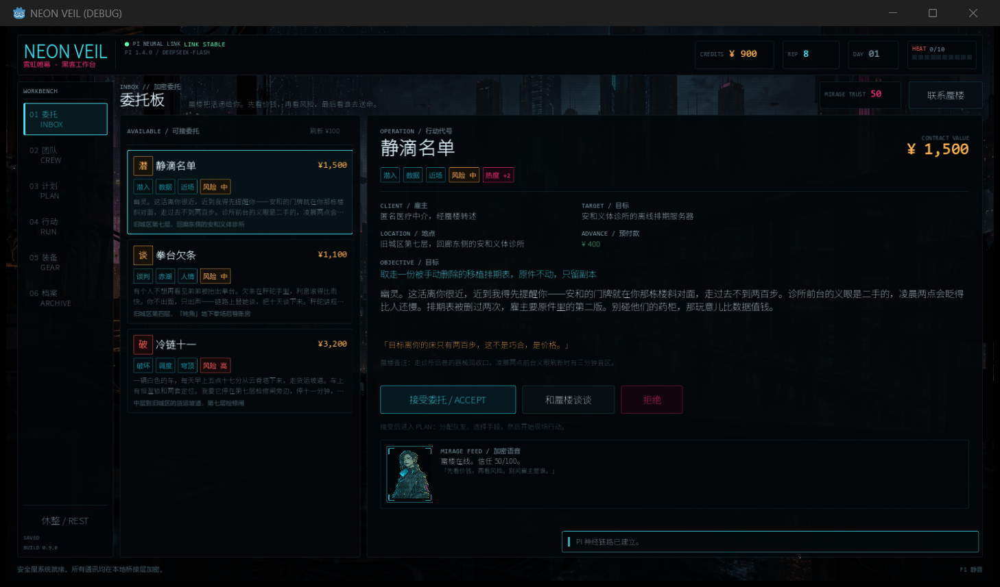

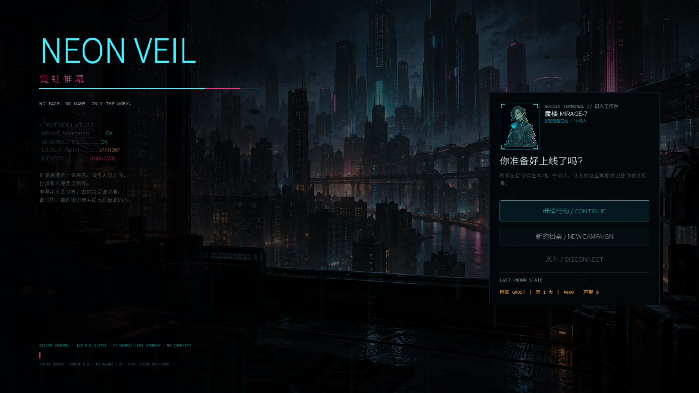

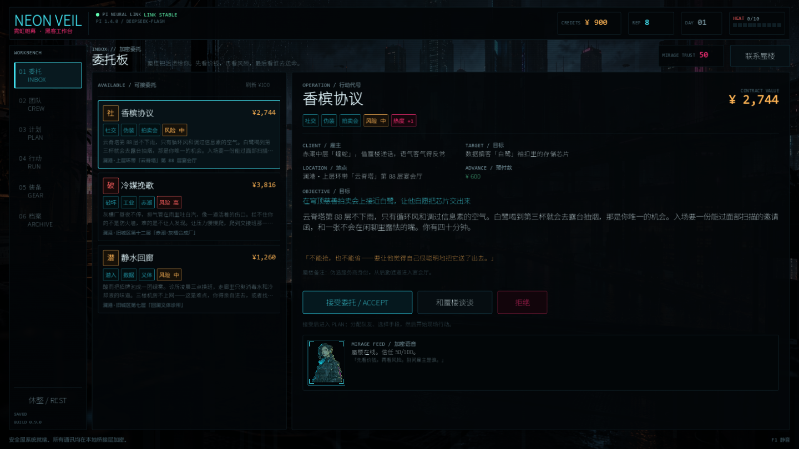

## 快速启动

环境要求：Windows、Godot 4.6、Node.js ≥ 22、已安装并登录可用的 `pi`（`@earendil-works/pi-coding-agent`）。

```bat
run.bat
```

或者：

```powershell
pwsh -ExecutionPolicy Bypass -File .\start.ps1
```

Windows PowerShell 5.1 也可以用；脚本会用 `curl --noproxy` 检查本地端口，避免系统代理阻塞 localhost。

脚本会：

1. 检查 `http://127.0.0.1:8791/health`，必要时在后台启动 `bridge/server.mjs`；
2. 启动 Godot 游戏窗口。

停止后台桥接服务：

```powershell
pwsh -ExecutionPolicy Bypass -File .\stop.ps1
```

只想验证界面 / 没有网络时，可以用本地叙事引擎跑完整循环：

```powershell
pwsh -ExecutionPolicy Bypass -File .\start.ps1 -Mock
```

> 第一次生成委托时，真实模型通常需要 15–30 秒；加载界面会显示已用时间与链路状态。之后每个行动节拍约 4–8 秒，对话约 2 秒首字。

## 操作

| 操作 | 说明 |
|---|---|
| 鼠标 | 选择委托、队友、计划、行动、装备 |
| 输入框 + Enter | 和中间人/队友自由对话，或输入任意现场指令 |
| `Esc` | 关闭通讯面板 / 弹窗 |
| `F1` | 开关音效 |
| `休整 / REST` | 推进一天：降低热度、恢复伤势、队友忠诚 +2，花 80 信用点 |

流程：**委托 INBOX → 团队 CREW → 计划 PLAN → 行动 RUN → 结算 DEBRIEF → 回到委托板**。

## 视觉与动效

接入 Codex 生成的 4 项美术资源，并全部通过 Godot Shader / Tween / 程序化控件实现动态表现：

- **雨夜霓虹城背景**（`game/assets/generated/neon-city-background.png`）：主界面与标题背景；Shader 负责暗化调色、两档雨幕、CRT 扫描线、暗角与数据扫光；鼠标移动有轻微视差，背景还会缓慢漂移/呼吸。工作台区域额外加 46% 暗色遮罩，保证文字可读。
- **蜃楼全息肖像**（`game/assets/generated/fixer-mirage-portrait.png`）：出现在标题、通讯面板、委托详情的 MIRAGE FEED、计划评估、结算与加载界面。Shader 对白色背景做键控透明、青色全息调色、扫描线、偶发横向撕裂和亮度闪烁；外层有 HUD 边框、角标，并叠加呼吸缩放/透明循环。
- **现场行动画面**（`game/assets/generated/neon-operation-scene.png`）：RunView 左栏的 `SITE CAM 03 / LIVE` 面板，三名队友在雨夜巷道靠近医疗塔，玩家不在画面中。Shader 做暗化、雨幕、扫描线、暗角；鼠标视差 + 节拍推进时轻微平移；判定成功/失败会给画面短暂染上绿/红。右侧独立文字栏保证 HUD 与叙事清晰，不压在画面上。
- **佣兵头像图集**（`game/assets/generated/mercenary-portrait-atlas.png`）：2×2 透明底，共 4 格。用 `AtlasTexture` 按格裁切，按职业确定性映射（潜入→0、重装/技术→1、交涉→2、撤离→3，未知职业用稳定哈希兜底），不写入存档字段，旧存档自动兼容。至少出现在 CrewView 卡片、详情页和 RunView 现场队友栏；每格有极轻的青色全息调色、扫描线、闪烁和轮廓辉光，详情页带 HUD 边框与呼吸动效。玩家仍没有任何形象。
- **入场与反馈**：委托/佣兵/装备卡片错峰淡入缩放；按钮悬停轻微放大；页面切换淡入；通讯消息滑入；行动节拍切换时处境文字淡入、当前阶段脉冲；D10 判定先滚动数字再定格结果，并闪烁屏幕边缘；结算净收入从 0 滚动到最终值；热度上升、警报升级都会触发对应颜色脉冲与音效。
- 动效都是非阻塞的 Tween/Shader，仅在骰子结算动画期间短暂禁用行动输入，不会拖慢 LLM 流式文本或按钮响应。

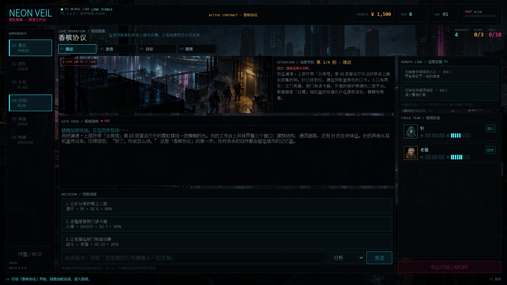

## 玩法

### 接活与谈判

- 中间人「蜃楼 MIRAGE-7」给出 3 份加密委托：代号、雇主、目标、地点、报酬、风险、热度、隐藏转折。
- 接受后在 PLAN 页面可以继续和蜃楼谈条件：加钱、预付款、要情报。能否谈成取决于你的声望、热度和话术。
- 每份委托的 `twist` 由 LLM 生成，Godot 只保存不展示，行动中才可能被揭开。

### 组队与关系

- 佣兵有角色、出身、性格、怪癖、喜欢/讨厌、8 项能力、分成要求、忠诚、秘密。
- 招募需要谈判；报价低于标准分成 80% 基本会被拒绝，高于 95% 通常直接接受。中间地带由角色自己决定。
- 忠诚度会随任务结果、伤势、你说话的方式变化；忠诚 ≥ 70 时角色可能主动透露秘密。
- 每个角色都有独立的 Pi 会话：**同一角色的记忆跨任务、跨存档继续存在**。

### 计划

- 选择进入方式、行动手段、撤离方式、随行队友与携带装备。
- 界面会实时推演每一拍的 DC、成功率、队友分成和预估净收入。
- 可以让蜃楼做一次「计划评估」，指出计划里的愚蠢死法。
- 行动最多带 3 名队友；也可以独自行动——所有物理动作都会更难。

### 行动

- 4 个节拍：接近 → 渗透 → 目标 → 撤离。
- 每个节拍由 LLM 给出具体处境、3 个可选行动、1–3 个远程支援操作。
- 判定由 Godot 掷 d10 + 能力 + 装备/支援，对照 DC：
  - 大成功 / 成功 / 勉强 / 失败
  - 失败会提升警报、热度，并可能让队友受伤。
- 远程支援消耗带宽；成功会让下一次现场行动 +2。
- 也可以随时输入**自由指令**，选择远程技能，由系统判定后交给 LLM 续写。
- 警报到 3 级会强制撤离，收益打折，热度上升。

### 结算与后续

- 净收入 = 基础报酬 × 成功比例 − 预付款 − 队友分成 − 医疗费 + 战利品。
- 成功节拍、警报、伤势、队友台词、世界变化、下一步钩子都由 LLM 写成收尾。
- 世界会记住：热度过高会引来更多麻烦，队友会记住你有没有把他们当人，下一批委托会回收上一单的后果。
- 每个行动结束后自动保存。标题界面可以继续上一档。

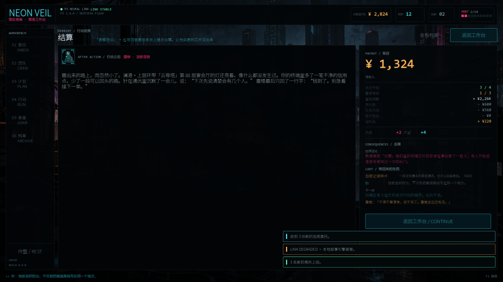

## 架构

```
┌──────────────────────────────┐
│ Godot 4.6 游戏               │
│  UI / 状态机 / 掷骰 / 经济    │
│  存档 user://campaign.json    │
└──────────────┬───────────────┘
               │ WebSocket JSONL（流式）
┌──────────────▼───────────────┐
│ Node 桥接 bridge/server.mjs   │
│  请求路由 / Prompt / 解析     │
│  会话管理 / 超时 / 回退       │
└──────────────┬───────────────┘
               │ @earendil-works/pi-coding-agent SDK
┌──────────────▼───────────────┐
│ 本地 Pi agent 1.4.0           │
│  DeepSeek deepseek-flash      │
│  每个角色一个持久会话          │
└──────────────────────────────┘
```

- **Godot 是权威**：LLM 不能直接改钱、热度、伤势或胜负。它返回结构化的「建议效果」，由 Godot 校验、夹取、结算。
- **Pi 是叙事引擎**：委托、佣兵、现场、对话、收尾由真实模型生成，支持流式输出。
- **桥接层**：无第三方依赖的 WebSocket 服务；每类任务有明确的 prompt 与输出协议；解析失败或链路故障时自动切到本地叙事引擎，保证游戏可继续。
- **记忆**：GM / 蜃楼 / 每名佣兵各自维护会话；Godot 还会把精简的世界状态、编年史、关系数字注入每次请求。两者叠加，形成「世界 + 角色」的持续记忆。

### 目录

```
game/                 Godot 4.6 项目
  scripts/
    autoload/         UI 主题、音效、GameState、Bridge、FX 动效
    views/            Inbox / Crew / Plan / Run / Settle / Gear / Archive
    ui/               ChatPanel、Meter、Background、Portrait、FrameCorners
  assets/fonts/       Noto Sans SC（OFL-1.1）；等宽字体使用系统字体
  assets/generated/   neon-city-background.png + fixer-mirage-portrait.png + neon-operation-scene.png + mercenary-portrait-atlas.png
bridge/
  server.mjs          WebSocket + 任务编排
  pi.mjs              Pi SDK 会话层（每角色独立 session）
  prompts.mjs         世界观、角色卡、各任务 Prompt
  parse.mjs           容错 JSON / 标记解析 / 字段夹取
  mock.mjs            离线叙事引擎（回退 + 无网演示）
  logs/               LLM 调用证据（llm-*.jsonl）与运行日志
start.ps1 / stop.ps1  启动与停止
captures/             实际运行截图
```

## 已验证

- **真实 LLM 完整循环**：`godot --headless --path game -- --test-loop`，使用 `deepseek-flash` + Pi 1.4.0，真实生成 3 份委托、3 名佣兵、行动开局、4 个节拍、收尾结算，全部解析通过，退出码 0。
- **UI 全流程截图**：标题 / 建角 / 委托板 / 团队 / 计划 / 行动 / 结算 / 装备 / 档案 / 通讯，均已在实际窗口中渲染并截图（见 `captures/`）。
- **存档与继续**：继续行动可恢复日期、金钱、声望、热度、队伍、委托与世界编年史；当前行动节拍与结算数据也会持久化。真实窗口点击「接受委托」进入 PLAN、恢复存档后重新继续，均已实测。
- **离线回退**：桥接层连续失败后会开启 90 秒本地叙事模式；`-Mock` 模式下整个循环不依赖网络。
- **视觉阶段**：真实窗口验证标题/委托/团队/计划/行动/结算/装备/档案/通讯全部使用新背景、肖像与动效；D10 滚动、结算数字滚动、页面入场、热度/警报脉冲均有截图或运行日志佐证；真实存档继续行动后仍可玩。
- **佣兵头像**：旧存档中的 3 名佣兵（撤离/交涉/重装）在无需迁移的情况下自动映射到 3 个不同图集格；CrewView 卡片、详情页和 RunView 现场队友栏均已实测，玩家仍无任何形象。
- **证据**：`bridge/logs/llm-*.jsonl` 记录了每次真实调用的任务、耗时、token 用量和原始返回。

## 更多截图

| | |
|---|---|
| 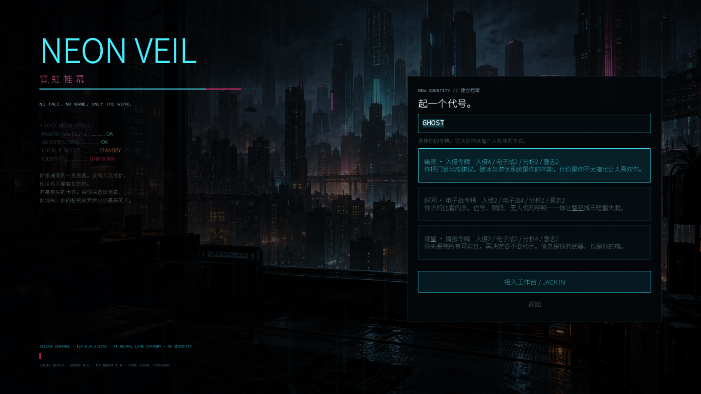 | 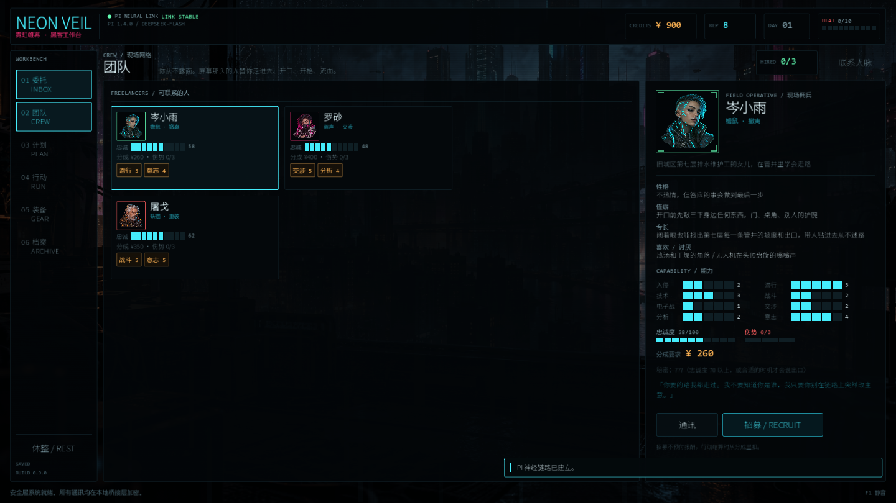 |
|  | 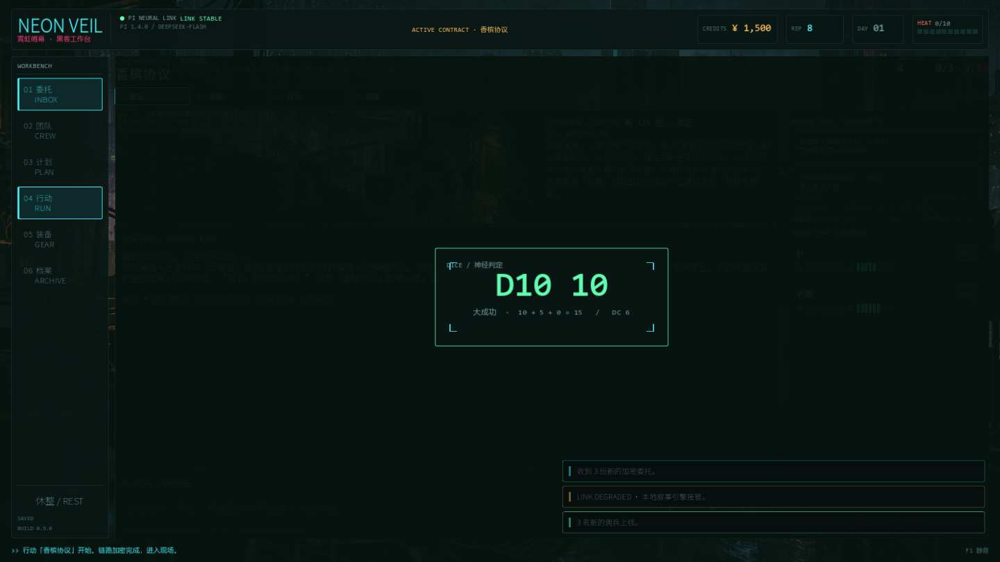 |
| 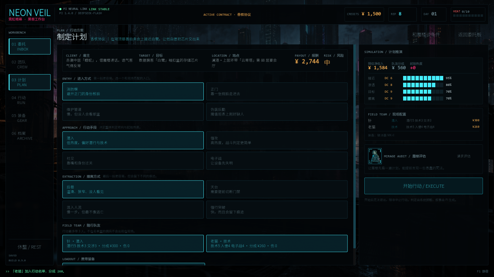 | 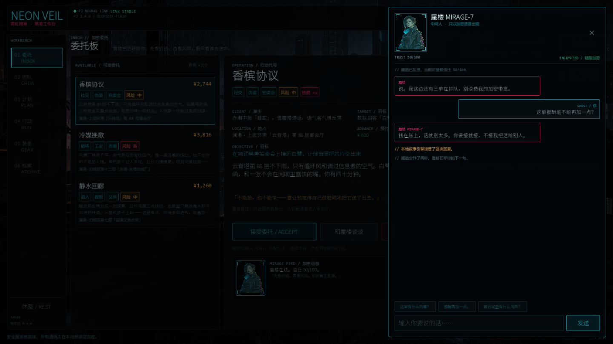 |
| 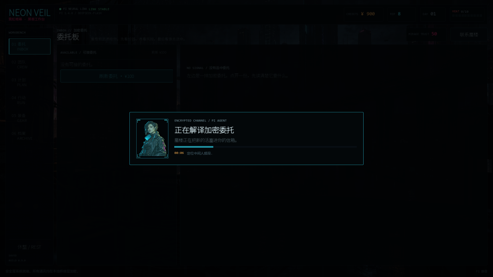 | 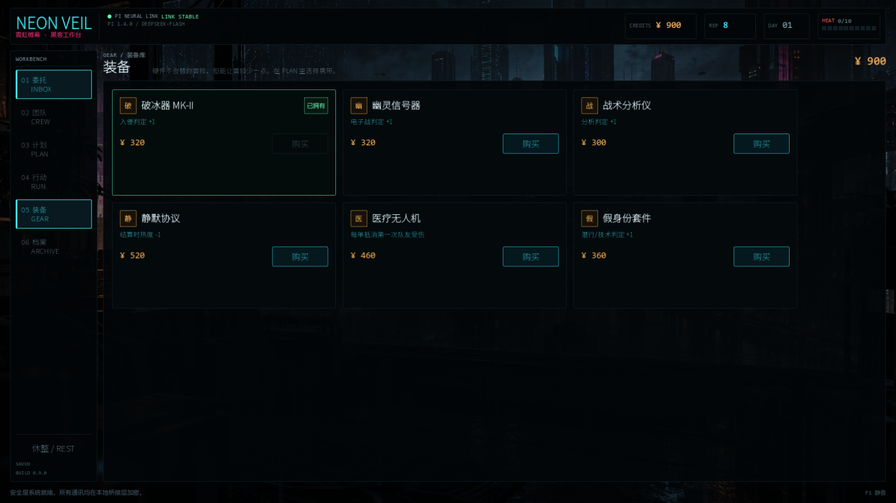 |
| 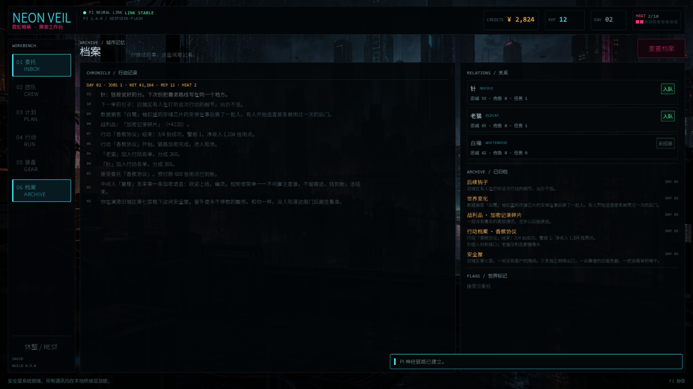 |  |

协议与内部设计见 [docs/ARCHITECTURE.md](docs/ARCHITECTURE.md)；详细测试记录见 [docs/TEST-REPORT.md](docs/TEST-REPORT.md)。

## 已知限制

- 这是一个本地单人原型：没有账号系统、多人联机或云存档。
- 真实模型的措辞偶尔会与数值有小冲突（例如角色嘴上抱怨价格，但机制上已经接受）；桥接层会对数值做夹取，但不会重写每一句台词。
- 首次生成和模型高峰期的等待时间取决于网络与 DeepSeek 服务。
- 游戏内所有技术描写均为虚构氛围，不包含现实可执行的入侵步骤。

## 重置

游戏内：`档案 ARCHIVE → 重置档案`。这会删除 `user://campaign.json` 和该战役的 Pi 会话。

命令行：

```powershell
Remove-Item "$env:APPDATA\Godot\app_userdata\NEON VEIL\campaign.json" -ErrorAction SilentlyContinue
Remove-Item "bridge\sessions\*" -Recurse -Force -ErrorAction SilentlyContinue
```


